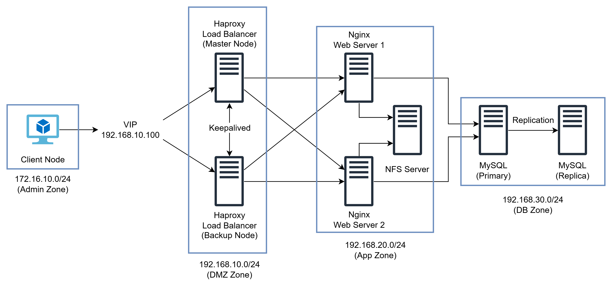
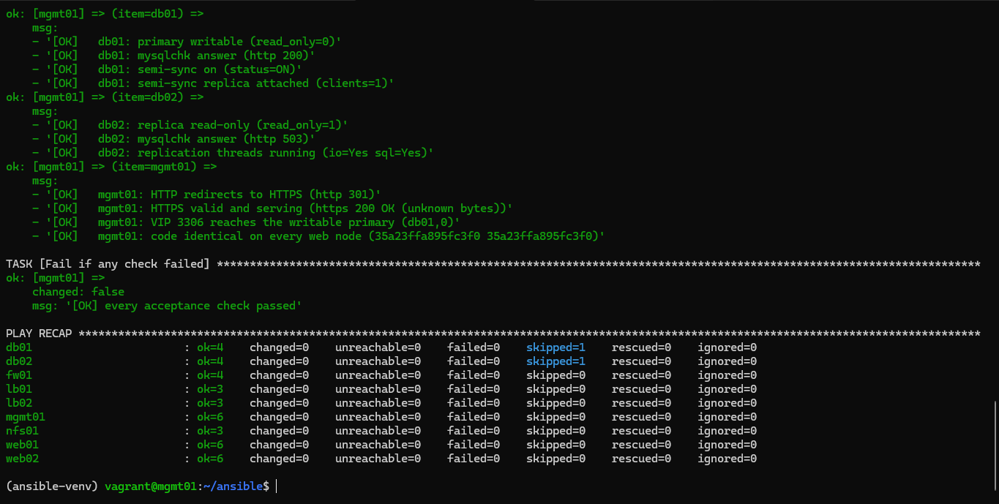
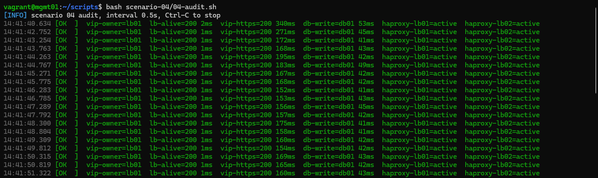
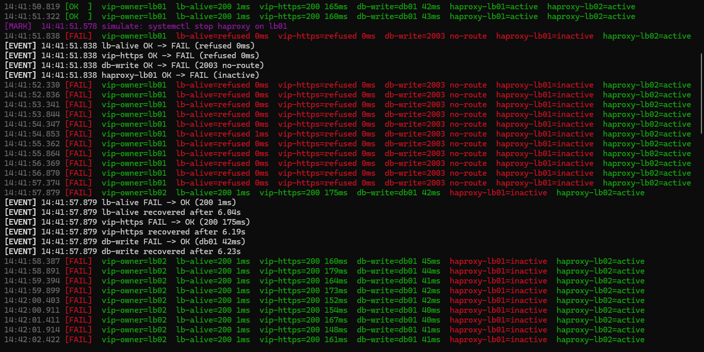
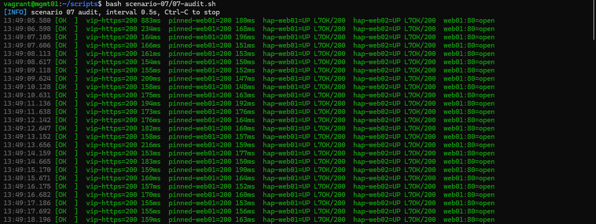
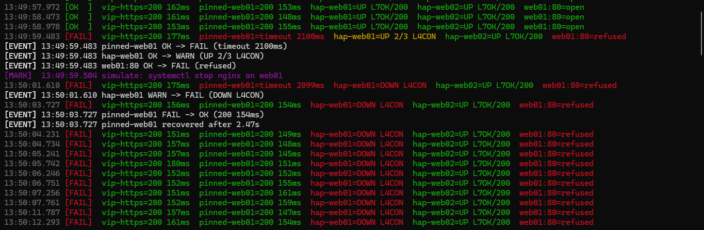
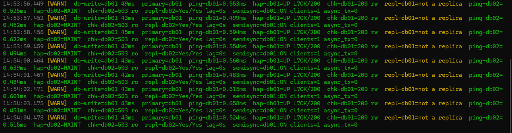
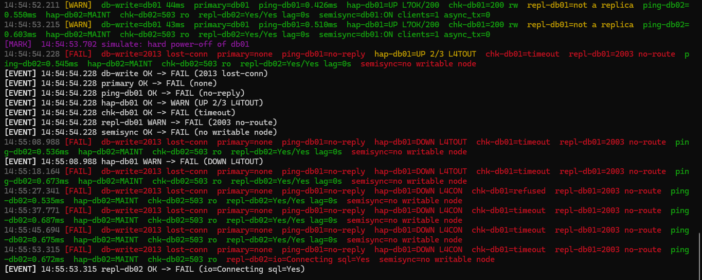

# On-Premise High-Availability WooCommerce Lab

## Table of contents

- [Project overview](#project-overview)
  - [What this project is](#what-this-project-is)
  - [Goals](#goals)
- [System architecture](#system-architecture)
  - [Diagram](#diagram)
  - [All machines](#all-machines)
- [Tech stack](#tech-stack)
- [Repository layout](#repository-layout)
- [How to run it](#how-to-run-it)
- [Failure test scenarios](#failure-test-scenarios)
  - [How every test is run](#how-every-test-is-run)
  - [Scenario overview](#scenario-overview)
  - [Scenario 04 — the active load balancer dies](#scenario-04--the-active-load-balancer-dies)
  - [Scenario 07 — a web node stops serving](#scenario-07--a-web-node-stops-serving)
  - [Scenario 16 — the database primary dies](#scenario-16--the-database-primary-dies)
  - [Results summary](#results-summary)
- [Known limitations](#known-limitations)
- [What I learned](#what-i-learned)

---

## Project overview

### What this project is

An on-premise high-availability lab, built with 9 Ubuntu 24.04 VMs, running a
WordPress + WooCommerce shop at `https://shop.lab.internal`. It has no single point of
failure on any layer that serves a request, and it is installed entirely by Ansible.

- Four routed network zones (DMZ, app, database, admin); every cross-zone packet goes
  through one router VM, like a real datacenter network.
- Two load balancers share one virtual IP; if the active one dies, the other takes over.
- Two web nodes with byte-identical code, deployed only by Ansible.
- Two MySQL nodes with GTID replication and semi-sync, so a confirmed order always exists
  on two machines.
- 18 failure scenarios that break the lab on purpose and measure what it does.

### Goals

These were the acceptance targets I set before starting, and every one had to be **measured**,
not assumed from a config file.

| Target | Required | How it is checked |
|---|---|---|
| Uptime | 99.9% per month (≈43.8 min downtime) | measured outage per scenario |
| Virtual IP failover | under 6 seconds | scenario 04 |
| Broken web node removed | about 6 seconds, no user-visible error | scenario 07 |
| Database failover | under 5 minutes, average of 3 drills | scenario 16 |
| Lost confirmed orders | zero | scenario 16, order counter + reconcile script |
| HTTPS | TLS 1.2 minimum, correct certificate name | scenario 06 |
| Repeatable automation | `ansible-playbook site.yml` reports `changed=0` on the second run | second run |
| Failure testing | at least 12 scenarios, each with inject + rollback + write-up | 18 built |

---

## System architecture

### Diagram



### All machines

| Node | Zone and IP | RAM | vCPU | Job |
|---|---|---|---|---|
| `fw01` | all 4 zones, `.254` | 512 MB | 2 | Router between zones, DNS server, NTP server |
| `lb01` | dmz `192.168.10.11` | 512 MB | 1 | HAProxy + Keepalived, master node |
| `lb02` | dmz `192.168.10.12` | 512 MB | 1 | HAProxy + Keepalived, backup node |
| `web01` | app `192.168.20.11` | 1 GB | 2 | Nginx + PHP-FPM |
| `web02` | app `192.168.20.12` | 1 GB | 2 | Nginx + PHP-FPM |
| `nfs01` | app `192.168.20.21` | 512 MB | 1 | Shared storage for uploaded images |
| `db01` | db `192.168.30.11` | 1.5 GB | 2 | MySQL, primary |
| `db02` | db `192.168.30.12` | 1.5 GB | 2 | MySQL, replica |
| `mgmt01` | admin `172.16.10.11` | 1 GB | 2 | Control node: Ansible, test scripts (k6) |

The virtual IP `192.168.10.100` is the only address a user ever connects to. It is owned by Keepalived and moves between `lb01` and `lb02`.

---

## Tech stack

| Area | Technologies |
|---|---|
| Operating system | Ubuntu 24.04 LTS on all 9 VMs, from one `bento/ubuntu-24.04` box |
| Virtualization | VMware Workstation Pro 25H2, Vagrant 2.4.9, 5 virtual networks |
| Automation | ansible-core 2.20 in a virtualenv on `mgmt01`, secrets in Ansible Vault |
| Load balancer | HAProxy 3.3 (upstream repo), Keepalived 2.2.8 |
| Web | Nginx 1.30.5 (upstream repo), PHP-FPM 8.3 |
| Application | WordPress 7.0.x + WooCommerce 11.1.x, managed with WP-CLI |
| Database | MySQL Community 8.4 LTS (Oracle repo), GTID replication with semi-sync |
| Shared storage | NFS v4.2 |
| Routing and services | Linux kernel forwarding, bind9 (internal DNS), chrony (NTP) |
| Internal TLS | Self-signed certificate authority |
| Testing | Bash scripts with a live dashboard, Python 3.12 + PyMySQL for order/RPO measurement, k6 for load |

---

## Repository layout

```
├── Vagrantfile                        all 9 VMs, networks and NICs matched by MAC address
├── vagrant-provision/
│   ├── bootstrap.sh                   the minimum needed before Ansible can log in
│   └── ansible-key.pub                shared SSH key, must exist before the first vagrant up
├── ansible/
│   ├── README.md                      what runs where, and where every value lives
│   ├── ansible.cfg
│   ├── requirements.yml               collections pinned for the build
│   ├── site.yml                       builds the whole lab in one run
│   ├── verify.yml                     the acceptance tests, written as a playbook
│   ├── inventories/
│   │   ├── hosts.yml                  every IP address, declared once
│   │   └── group_vars/all/            vars.yml, plus the Vault file and its example
│   └── roles/                         common, router, nfs_server, nfs_client, mysql,
│                                      mysqlchk, haproxy (with the internal PKI),
│                                      keepalived, nginx_php, wordpress, mgmt
├── scripts/
│   ├── README.md                      how to run a scenario, and what to check first
│   ├── lib/common.sh                  shared SSH helpers, probes, the dashboard loop
│   ├── tools/gen-vault.sh             random secrets for a fresh lab
│   └── scenario-NN/                   one folder per failure test (18 of them)
│       ├── NN-audit.sh                continuous dashboard: before, during, after
│       ├── NN-simulate.sh             injects the fault once
│       ├── NN-rollback.sh             restores the healthy state and proves it
│       └── NN-troubleshoot.md         manual diagnosis, root cause at the bottom
├── docs/
│   ├── how-to-setup.md                the manual build of every VM, from nothing
│   ├── scenarios-demo.md              all 18 failure tests in detail
│   └── images/                        screenshots and diagrams, one folder per scenario
└── linux_project.drawio               source of the topology diagram
```

Scenario 16 is the only one with extra files: `16-order-writer.py` writes orders
continuously and `16-rpo-check.py` reconciles them after the failover.

---

## How to run it

The host needs VMware Workstation Pro, Vagrant with the `vagrant-vmware-desktop` plugin,
and the 5 VMnets from [docs/how-to-setup.md](docs/how-to-setup.md), which also documents the
manual build of every VM behind the Ansible roles.

On the Windows host:

```powershell
vagrant up --provider vmware_desktop     # build all 9 VMs
vagrant ssh mgmt01                       # jump into the control node
```

On `mgmt01`:

```bash
source ~/ansible-venv/bin/activate
chmod o-w ~/linux_project/ansible      
cd ~/linux_project/ansible   
export ANSIBLE_CONFIG=$PWD/ansible.cfg

ansible-galaxy collection install -r requirements.yml -p ./collections
bash ~/linux_project/scripts/tools/gen-vault.sh 

ansible all -m ping
ansible-playbook site.yml
ansible-playbook verify.yml
```

`verify.yml` prints one line per check, so a healthy lab looks like this:

<!-- TODO: screenshot of a green verify.yml run -->
<!-- Suggested file: docs/images/architecture/verify-green.png -->



A second `site.yml` run must report `changed=0`; anything still `changed` is a bug in that
task. More detail on what each play does and where every value lives:
[ansible/README.md](ansible/README.md).

---

## Failure test scenarios

This is the part I spent the most time on. Building a system that works is one thing;
knowing **how it behaves when it breaks** is the part the job actually needs.

Each test is kept simple on purpose: stop a service, power off a VM, or change one config
line. The value is not in a clever fault, it is in having a **baseline measurement**, a
**measurement during the fault**, and a repeatable way back.

### How every test is run

Each scenario folder has four files:

| File | What it does |
|---|---|
| `NN-audit.sh` | A live dashboard. Starts **before** the fault and keeps probing every half-second to few seconds, so the before / during / after state is on screen and in a log file |
| `NN-simulate.sh` | Injects the fault once |
| `NN-rollback.sh` | Restores the system and waits until the healthy state is proven again |
| `NN-troubleshoot.md` | A manual checklist. I diagnose by hand and only read the root cause at the bottom afterwards |

Two terminals on `mgmt01`, from `scripts/` ([scripts/README.md](scripts/README.md) has the
options and the pre-flight checks):

```bash
# terminal 1 — start watching before anything breaks
bash scenario-04/04-audit.sh

# terminal 2 — break it, diagnose by hand, then restore
bash scenario-04/04-simulate.sh
less scenario-04/04-troubleshoot.md
bash scenario-04/04-rollback.sh
```

When I stop the dashboard it prints a summary: for every check, how many probes failed, the
longest single outage and the total outage. **Those are the numbers in the tables below** —
none of them are estimates.

### Scenario overview

All 18, with the detail of each one in
[docs/scenarios-demo.md](docs/scenarios-demo.md):

| # | What I break | Layer | What stays green and hides the problem |
|---|---|---|---|
| 01 | IP forwarding off on the router | network | the router still answers ping |
| 02 | A route removed on one web node | network | the node still answers health checks |
| 03 | Internal DNS down | network | anything using an IP address instead of a name |
| 04 | Active load balancer stopped | load balancer | nothing — it recovers by itself |
| 05 | VRRP blocked, both LBs claim the IP | load balancer | each LB thinks it is fine |
| 06 | Certificate with the wrong name | load balancer | the backends, and `curl -k` |
| 07 | Nginx stopped on one web node | web | the site, served by the other node |
| 08 | PHP-FPM dead, Nginx still up | web | static files on that node |
| 09 | NFS server down | storage | the web health check |
| 10 | Storage export revoked for one node | storage | both web nodes look UP |
| 11 | Disk full on a web node | OS | the health check — this is the original incident |
| 12 | Database grant on the wrong source IP | database | every health check |
| 13 | Primary restarts and stays read-only | database | `systemctl status mysql` |
| 14 | Database health-check port blocked | database | MySQL itself, still writable |
| 15 | Replica down, replication silently drops to async | database | the shop, it keeps working |
| 16 | Primary powered off, manual failover | database | nothing — this one is loud |
| 17 | Code different between the two web nodes | application | every check |
| 18 | One web node loses its database path | application | its own health check, by design |

Three of them are written up below: one per layer that has redundancy.

---

### Scenario 04 — the active load balancer dies

**What I break:** `systemctl stop haproxy` on whichever load balancer currently holds the
virtual IP.

**What should happen:** Keepalived notices HAProxy is gone, lowers its own priority, and the
standby load balancer takes the virtual IP. The target is **under 6 seconds**, with the
number of failed requests recorded.

**Baseline (healthy system):**

<!-- TODO: screenshot the audit dashboard BEFORE running simulate -->


| Check | Baseline state |
|---|---|
| Virtual IP owner | `lb01` |
| HTTPS on the site | `200 OK`, TBD ms |
| MySQL write through the virtual IP | OK |
| HAProxy on lb01 / lb02 | active / active |

**During and after the fault:**

<!-- TODO: screenshot the dashboard showing the [MARK] line and the VIP moving -->


| Check | Failed probes | Longest outage | Total outage |
|---|---|---|---|
| `vip-owner` | TBD | TBD | TBD |
| `lb-alive` | TBD | TBD | TBD |
| `vip-https` | TBD | TBD | TBD |
| `db-write` | TBD | TBD | TBD |

| Measurement | Result | Target | Pass? |
|---|---|---|---|
| Virtual IP moved to `lb02` in | TBD s | < 6 s | TBD |
| HTTPS requests that failed | TBD | — | — |
| Database connections dropped | TBD | — | — |

**How I diagnosed it:** check which node holds the virtual IP, confirm the Keepalived state
on both nodes, then look at the check script Keepalived runs. The dashboard's `[EVENT]`
lines give the exact recovery time, so the failover duration is read off the log instead of
being timed with a stopwatch.

**Note on recovery:** when `lb01` comes back it takes the virtual IP again, because it has
the higher priority. That is a deliberate choice — the state is always predictable — and the
cost is one more short interruption on recovery.

→ Full write-up: [docs/scenarios-demo.md](docs/scenarios-demo.md#scenario-04-the-active-haproxy-dies-and-the-vip-moves)

---

### Scenario 07 — a web node stops serving

**What I break:** `systemctl stop nginx` on `web01`.

**What should happen:** HAProxy's health check fails three times, the node is taken out of
rotation in about 6 seconds, and the site keeps working on `web02`. A user should see no
error at all.

**Baseline (healthy system):**

<!-- TODO: screenshot the audit dashboard before the fault -->


| Check | Baseline state |
|---|---|
| HTTPS on the site | `200 OK` |
| web01 in HAProxy | UP |
| web02 in HAProxy | UP |
| Port 80 on web01 | open |

**During and after the fault:**

<!-- TODO: screenshot showing web01 going DOWN while the site stays 200 -->


| Check | Failed probes | Longest outage | Total outage |
|---|---|---|---|
| `vip-https` | TBD | TBD | TBD |
| `hap-web01` | TBD | TBD | TBD |
| `hap-web02` | TBD | TBD | TBD |
| `pinned-web01` (a user already stuck to web01) | TBD | TBD | TBD |

| Measurement | Result | Target | Pass? |
|---|---|---|---|
| Time for HAProxy to mark web01 DOWN | TBD s | ≈ 6 s | TBD |
| Site requests that failed | TBD | 0 | TBD |
| Requests failed for a user pinned to web01 | TBD | — | — |

**How I diagnosed it:** read the HAProxy stats page to see which backend went down and the
reason it printed, then check the service on the node itself. HAProxy tells you *why* it
dropped a node, and each reason points at a different layer — that one habit saved the most
time across all 18 tests.

**What this test exposed:** HAProxy uses a sticky cookie, so a user already pinned to
`web01` is a slightly different case from a new visitor. Measuring both is the only way to
say honestly whether the failure was invisible.

→ Full write-up: [docs/scenarios-demo.md](docs/scenarios-demo.md#scenario-07-nginx-stopped-on-one-web-node)

---

### Scenario 16 — the database primary dies

This is the most important test in the project, because it is the one that can lose money.

**What I break:** the writable database node is powered off instantly, with no shutdown —
the software equivalent of pulling its power cable.

**What should happen:** nothing automatic. By design, **no database failover happens on its
own.** A human follows a runbook: confirm the old primary is really dead, promote the
replica, open write access, point the load balancer at the new primary, verify. The targets
are **under 5 minutes** to recover and **zero lost confirmed orders**.

**How the numbers are measured:** a script writes orders continuously and only records an
order ID **after** the database confirms the commit. After the failover, a second script
compares what the client thinks it confirmed against what actually exists in the database.
Anything missing is real data loss.

```bash
python3 scenario-16/16-order-writer.py     # terminal 3, keeps writing orders
bash scenario-16/16-simulate.sh            # power the primary off
# follow the runbook in 16-troubleshoot.md by hand, timing it
python3 scenario-16/16-rpo-check.py        # reconcile confirmed vs. stored
```

**Baseline (healthy system):**

<!-- TODO: screenshot the audit dashboard before the fault -->


| Check | Baseline state |
|---|---|
| Writable node | `db01` |
| Replication threads on db02 | both running |
| Semi-synchronous replication | ON, 1 replica connected |
| Replication lag | TBD ms |
| Orders written per second | TBD |

**During the fault:**

<!-- TODO: screenshot the dashboard at the moment the primary disappears -->


<!-- TODO: screenshot of the manual failover steps in the terminal -->


| Check | Failed probes | Longest outage | Total outage |
|---|---|---|---|
| `db-write` | TBD | TBD | TBD |
| `primary` | TBD | TBD | TBD |
| `chk-db01` | TBD | TBD | TBD |
| `chk-db02` | TBD | TBD | TBD |
| `semisync` | TBD | TBD | TBD |

**Results over 3 drills:**

| Drill | Recovery time (RTO) | Orders confirmed | Orders found in DB | Lost orders (RPO) |
|---|---|---|---|---|
| 1 | TBD | TBD | TBD | TBD |
| 2 | TBD | TBD | TBD | TBD |
| 3 | TBD | TBD | TBD | TBD |
| **Average** | **TBD** | — | — | **TBD** |

| Measurement | Result | Target | Pass? |
|---|---|---|---|
| Mean recovery time over 3 drills | TBD | < 5 min | TBD |
| Confirmed orders lost | TBD | 0 | TBD |

**Comparison: with and without semi-synchronous replication**

The zero-data-loss promise comes from semi-synchronous replication. To show it actually
matters, I ran the same drill with it switched off:

| Mode | Confirmed orders | Orders found in DB | Lost orders |
|---|---|---|---|
| Semi-synchronous | TBD | TBD | TBD |
| Asynchronous | TBD | TBD | TBD |

**How I diagnosed it:** this fault is loud, so the work is not finding it — it is doing the
recovery safely and in the right order. The runbook forces three safety checks before
anything is promoted: the old primary must be confirmed down, exactly one node may be
writable at any moment, and the old primary must never rejoin without checking first that it
did not accept writes nobody else has.

→ Full write-up: [docs/scenarios-demo.md](docs/scenarios-demo.md#scenario-16-the-primary-dies-manual-failover)

---

### Results summary

| # | Scenario | Measured impact | Recovery | Target met |
|---|---|---|---|---|
| 01 | Router forwarding off | TBD | TBD | TBD |
| 02 | Route removed on a web node | TBD | TBD | TBD |
| 03 | Internal DNS down | TBD | TBD | TBD |
| 04 | Active load balancer stopped | TBD | TBD (automatic) | TBD |
| 05 | VRRP blocked, split brain | TBD | TBD | TBD |
| 06 | Wrong certificate name | TBD | TBD | TBD |
| 07 | Nginx stopped on one web node | TBD | TBD (automatic) | TBD |
| 08 | PHP-FPM dead on one web node | TBD | TBD (automatic) | TBD |
| 09 | NFS server down | TBD | TBD | TBD |
| 10 | Export revoked for one node | TBD | TBD | TBD |
| 11 | Disk full on a web node | TBD | TBD | TBD |
| 12 | Grant on the wrong source IP | TBD | TBD | TBD |
| 13 | Primary restarts read-only | TBD | TBD | TBD |
| 14 | Health-check port blocked | TBD | TBD | TBD |
| 15 | Replica down, async fallback | TBD | TBD | TBD |
| 16 | Primary dies, manual failover | TBD | TBD (manual) | TBD |
| 17 | Code drift between web nodes | TBD | TBD | TBD |
| 18 | Web node loses its DB path | TBD | TBD | TBD |

<!-- TODO: fill this in as you complete each scenario. -->
<!-- "Measured impact" = the worst total_outage from the audit summary. -->
<!-- "Recovery" = how long until the audit showed healthy again. -->

---

## Known limitations

I would rather state these clearly than let someone find them. Each one is a deliberate
trade-off, and each one has a known fix that was out of scope for a lab on a single PC.

| Limitation | Why it is accepted | What a real deployment would do |
|---|---|---|
| **No firewall on any node.** The four zones are routed and separate, but nothing enforces which zone may talk to which. A web node *can* reach the database zone directly; only the MySQL grant stops it | Two filter layers plus routing meant three places to look for every broken flow, and a routing fault and a firewall fault look identical. Removing it made reachability a pure routing question | Put the zone policy back as `nftables` rules on the router, plus a host firewall per node |
| **`nfs01` is a single point of failure.** If shared storage dies, uploads stop | A clustered filesystem is a project of its own | GlusterFS, DRBD + Pacemaker, or object storage |
| **`fw01` is a single router**, so it is a single point of failure for every cross-zone flow — including order writes | A second router would double the network complexity in a lab about *application* HA | A second router with VRRP, or collapsing the zones |
| **No automatic database failover** | Deliberate: see the decision table. Automatic promotion without real fencing risks two primaries and corrupt orders | Orchestrator or ProxySQL with real fencing |
| **Fencing is only simulated**, by powering the VM off and booting read-only | There is no real power control in a VM lab | STONITH through IPMI or a power distribution unit |
| **Everything runs on one physical PC** | It is a home lab | Separate physical hosts, separate racks |
| **Backup stops at rebuilding a replica** | Out of scope | A real backup and restore solution with tested restores |
| **No metrics, no central logging and no dashboards.** Faults are found by a dashboard script I start by hand before each test. A per-node health check with Telegram alerting is planned, but it is a local check, not an observability stack | Observability deserves a project of its own rather than being added in the time left at the end, so it is being built separately | Prometheus + Loki + Grafana, with an alert proven to fire for each of these 18 scenarios and the delay from fault to alert recorded |

---

## What I learned

The things I did not expect before starting:

- **A health check is a design decision, not a detail.** My first instinct was to make the
  web health check query the database, "to be thorough". That would have made one slow
  database take *both* web nodes out of rotation and turn a partial fault into a full
  outage. A shallow check is the correct answer, and the cost — it cannot see a database
  problem — has to be covered somewhere else.

- **The hardest faults are the quiet ones.** The loud failures (a VM powered off) are easy.
  The ones that cost real time are the faults where everything still looks green: replication
  silently falling back to asynchronous, a health-check port blocked while the database is
  perfectly healthy, or two web nodes slowly drifting apart. Those are the ones I built
  scenarios for on purpose.

- **"It pings" proves almost nothing.** A router answers ping on its own addresses even when
  it has stopped forwarding anything at all. I now check the specific thing I care about,
  not a neighbouring symptom.

- **Measure, do not estimate.** Every number in this README comes from a dashboard that was
  already running before the fault was injected. Starting the measurement *after* something
  breaks means the most interesting seconds are already gone.

- **Automate the safe layers, keep a human on the dangerous one.** Moving a virtual IP and
  dropping a dead web node are safe to automate. Promoting a database that holds order data
  is not, and saying "this is deliberately manual" is a stronger answer than automating it
  badly.

---

<sub>Self-study infrastructure project. All configuration is in this repository; the lab can
be rebuilt from scratch with `vagrant up` and `ansible-playbook site.yml`.</sub>
